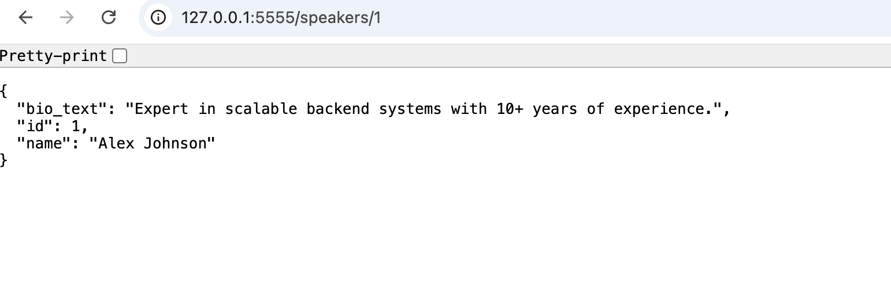

# EventWise: Modeling Relationships in Flask-SQLAlchemy

A Flask API for managing events, sessions, speakers, and speaker bios. It uses Flask-SQLAlchemy models with one-to-many, one-to-one, and many-to-many relationships, and returns all data as JSON.

## Models

- Event: has many Sessions. Deleting an event deletes its sessions.
- Session: belongs to an Event and has many Speakers.
- Speaker: has one Bio and many Sessions. Deleting a speaker deletes their bio.
- Bio: belongs to a Speaker.

Sessions and speakers are linked through the `session_speakers` association table.

## Setup

```
pipenv install
pipenv shell
cd server
export FLASK_APP=app.py
export FLASK_RUN_PORT=5555
flask db init
flask db migrate -m "Create tables with relationships"
flask db upgrade head
python seed.py
flask run
```

## Endpoints

- GET /events: all events
- GET /events/<id>/sessions: sessions for an event (404 if the event is missing)
- GET /speakers: all speakers
- GET /speakers/<id>: one speaker with bio_text, or "No bio available" (404 if missing)
- GET /sessions/<id>/speakers: speakers for a session, with bio_text (404 if missing)

## Testing

From the server folder:

```
pytest testing/
```

## Screenshot


